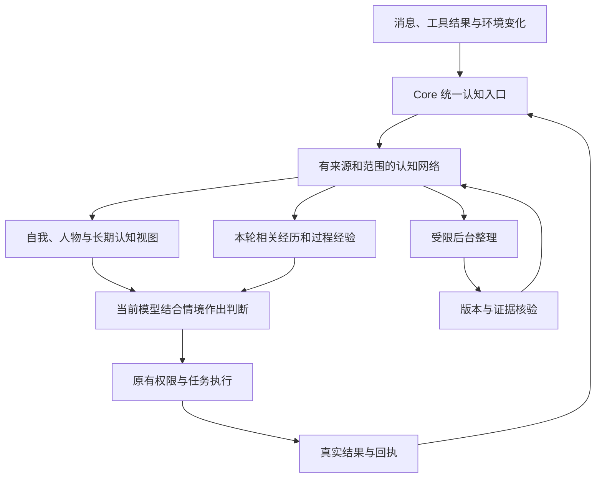

# 希洛统一认知系统施工方案：借鉴 Hindsight、Letta、ReMe

日期：2026-11-17；工程进度更新：2026-11-18。适用项目：bl-chat-plugin 独立 Agent Core。

**交付状态：首版统一认知链路及记忆评估回放已实现，2026-11-20 归并主线；默认关闭，未部署、未导入生产历史、未运行实模对照评测。** 实际落地、验证及剩余工作见第 14 节。本文承接[自主角色总路线](../autonomous-character-design-roadmap-2026-11-09.md)及本次会话确认的产品要求。历史实现和验收记录仍以原文及其证据为准。

**当前方向：借鉴三个项目，自研 Core 内的统一认知系统。** 希洛的经历、人物、兴趣、观点、目标、行动结果与过程经验共享身份和证据，通过明确的关系连接，形成“经历影响判断、判断影响行动、结果更新认知”的完整循环。

根据用户“不想用一些三方内容”和希望系统“像蜘蛛网一样”的补充，本版替代前一版接入 Hindsight 服务的建议。Hindsight、Letta、ReMe 均为设计参考，当前施工不引入其服务或 SDK。继续复用项目现有的存储、模型渠道和通用库；自研的对象是认知组织与生命周期，不重新实现数据库或大模型。

默认在同一个 Core 进程内组织这些能力，用一个认知入口提供服务。代码可以按职责分模块，但不允许各自建立一套身份、事实和成长结论。未来是否拆分进程由实际容量决定，不能因此产生多份互相冲突的希洛。

## 1. 已确认的产品要求

本节记录本次会话的需求依据，后文按这些要求施工，不用现有代码反过来改变它们。

用户明确指出：“多个机器人的人设是不一样的，所以是解耦的”；“在群聊和私聊里面的人设还是一个人”。因此业务上只说“机器人本人”“自我”“人设”。下文的 `agentId` 是 Core 已有技术标识，不额外引入一套用户需要理解的“角色”。

后续补充原话：“因为我不想让很多的模块散开,而是一个像蜘蛛网一样的整体系统,也许随着ai不断发展,过个几年,希洛也可以变成贾维斯呢”。工程上的理解是：各能力共享持久认知并形成反馈，后续模型和工具增强时能延续既有经历。这里没有把“几年后成为贾维斯”转成时间或能力承诺，也没有据此扩大现有执行权限。

| 编号 | 要求 | 可观察行为 |
| --- | --- | --- |
| R1 | 不同机器人是不同个体 | 即使使用相同人设模板，也不共享经历、喜好和成长记录 |
| R2 | 同一机器人跨群、私聊保持连续 | 在 A 群喜欢上一个游戏，到 B 群和私聊仍可喜欢它，不用逐群重新培养 |
| R3 | 自我连续与来源使用范围分别表达 | A 群某人准备辞职，不能在 B 群随口讲出，也不能改写成摘要后泄露 |
| R4 | 人物判断保留语境和证据地位 | A 群调侃、转述、推测不能自动成为某人的永久性格 |
| R5 | 记忆可发展、可纠正、可撤销 | 改变偏好能保留变化过程；删除来源后，摘要、缓存和迟到任务不能把它恢复 |
| R6 | 优先解决体验，不以实现数量证明优劣 | 与现有实现比较连续性、关联使用、来源正确性、成本和延迟，再决定启用范围 |
| R7 | 与 Core 迁移协作 | 沿用迁移后的身份、会话、存储和运行接口，在独立工作树开发和验证 |
| R8 | 尽量自主掌握核心实现 | 三个开源项目作为设计参考，当前方案不增加独立第三方记忆服务 |
| R9 | 各能力构成一个有联系的整体 | 同一经历可关联人物、兴趣、目标和结果；修订能影响后续读取与判断 |
| R10 | 为长期演进保留连续性 | 原始依据、有效自我和执行状态独立持久化；升级模型后经验证继续使用 |

范围边界是正常工程要求。选择自研主要来自自主掌握核心与整体集成的偏好；统一认知不会把不同群的聊天历史无条件混在一起。

首个可交付版本是：**统一自我档案＋带来源和关系的长期经历＋后台整理与修订＋经历到行动结果的闭环回放**。完整技能自演化、替换聊天运行时、自主增加工具权限不在首版内。

## 2. 从三个项目取什么

### 2.1 选型与依赖方式

| 来源 | 对我们最有用的部分 | 自研落点 | 与整体系统的关系 |
| --- | --- | --- | --- |
| Hindsight | 经历/事实 → 带证据的观察 → 长期认知页面，多路关联检索 | 扩展现有记忆存储、检索与事实反思，增加统一关系和可重建页面 | 人、事、偏好与结果连接到同一证据网络 |
| Letta | 持续存在的个体、精简核心记忆、详细记忆与技能按需读取 | 自研 `SelfProfile` 和上下文装配，沿用 Core 身份 | 全部场景读取同一个体的当前自我与相关经验 |
| ReMe | daily 与 digest 分离、增量整理、CREATE / CORROBORATE / REFINE / CORRECT | 整合现有反思入口，使用统一后台整理流程 | 新经历更新同一份认知，修订和失败沿同一生命周期传播 |

三者的思想进入同一个本地系统。事实抽取、认知整理、自我更新分阶段处理，使用同一来源和变更协议；不会分别运行三个“脑”后再拼接它们的答案。

长期认知页面借鉴 mental model 的组织方式，但由我们生成、失效和重建。它是有来源的派生知识，不是受保护人设的权威存储。普通回复默认不额外运行一轮完整反思，后台整理受同一金额和调用预算约束。

首版沿用现有存储与 TypeScript 工程，不为实现关系网络先引入图数据库、独立消息中间件或新的记忆服务。先测量数据规模与查询成本，再决定是否需要调整存储。Hindsight 为 MIT，ReMe 为 Apache-2.0；若后续复制源码，应按实际采用版本核对许可证并保留声明。Letta 当前调查对象是 `letta-code` 的记忆设计。

### 2.2 现状与需要改变的地方

最初调查快照：2026-11-17，HEAD 为 `db84d7dd2549270aa56da6482917a8a5f6e425b7`。2026-11-18 开发已重新固定到迁移完成后的 `4a9b336d248158f78e1510e58885bff5a5a70f92`，分支 `codex/unified-cognition-20261118`；原工作树当时干净。以下表格保留改造前的问题背景，当前新增实现见第 14 节，不作为线上状态报告。

| 当前事实 | 施工方向 | 依据 |
| --- | --- | --- |
| `CharacterScope` 包含 bot、persona、group，自我状态仍以群分区 | 自我归属于机器人个体，经历仍带完整会话来源 | [character 契约](../../src/contracts/character.ts)、[characterState](../../src/modules/simulation/domain/characterState.ts) |
| 跨群自我目前要逐条提议、由主人批准 | 合格的机器人自身普通偏好自然进入统一自我；含他人信息或语境不明的内容保留原范围 | [characterSharedSelf](../../src/modules/simulation/infrastructure/characterSharedSelf.ts) |
| 该角色状态最多 128 条记忆，提示选最近 12 条 | 用精简自我投影＋相关经历读取，避免近期条目挤走重要旧经历 | [characterState](../../src/modules/simulation/domain/characterState.ts)；128 不是整个项目的记忆容量 |
| 已有事实反思、BM25/CJK、向量、RRF 和可选重排 | 在此基础上统一来源与关系，测量新增关联检索和整理的增益 | [reflector](../../src/modules/memory/infrastructure/engine/reflector.ts)、[SemanticMemoryRetriever](../../src/modules/memory/infrastructure/SemanticMemoryRetriever.ts) |
| 人物记忆已有来源、可跨场景规则、墓碑与撤回 | 首版复用这些规则；不因引擎替换重开人物信息范围 | [personMemory 契约](../../src/contracts/personMemory.ts)、[领域规则](../../src/modules/memory/domain/personMemory.ts) |
| 独立反思已能依据真实记录更新少量观点/兴趣 | 合并为一个后台整理入口，避免两个任务重复强化同一条依据 | [characterReflection](../../src/modules/simulation/infrastructure/characterReflection.ts) |
| Core 已有 agent、完整会话地址和绑定版本 | 新接口消费这些契约，不再发明并行的机器人标识 | [agentBinding](../../src/contracts/agentBinding.ts)、[绑定说明](agent-bindings.md) |

现有能力已有正向证据：[11 月 13 日偏好修订与重启回放](../replays/2026-11-13-character-growth/README.md)、[日常兴趣与习惯回放](../replays/2026-11-13-everyday-character/README.md)。这些是隔离存储、合成群聊下的实模观察，仍有无关话题带入、依据表述偏强等现象，不能等同真实群长期验收。

## 3. 一个持续运行的认知整体



### 3.1 “蜘蛛网”连接什么

关系网络是共享的语义结构：已有对象通过稳定 ID 相连，不要求都复制到一张表。首版只支持有实际消费者的关系，避免为所有文本生成大量无用连线。

| 对象 | 示例关系 | 带来的行为 |
| --- | --- | --- |
| 人物、话题、经历 | 谁参与了什么、谈到哪个主题 | 从一个人或话题找回共同经历；身份不靠昵称匹配 |
| 经历、观点、兴趣 | 哪条依据支持、限定或修正哪个判断 | 可以解释喜好与变化，旧结论不覆盖新结论 |
| 兴趣、目标 | 哪个兴趣促成了哪个目标 | 新机会能与已有关注点联系，而非每次从零规划 |
| 目标、行动、回执 | 为哪个目标做了什么，结果是否确认 | 持续工作有上下文；计划、失败与未知不冒充完成 |
| 回执、过程经验 | 哪些实际结果支持某种做法 | 下次类似任务能调用经验，也知道适用条件 |

关系也有来源、范围、版本、时间与有效状态。“相关”不等于“导致”，“支持”不等于“证明”，模型推测的关系标为推断。语义关系可以成环，作为证据的派生依赖必须拒绝循环自证。

例如：她参与一次文字游戏，形成对合作玩法的兴趣；后来接受一个相关创作目标，沿用先前经历选择方案；创作工具返回实际结果，整理成下一次可用的经验。经历、兴趣、目标、回执保留各自状态，但下一次判断能够把它们联系起来。若游戏中的某位群友另谈了辞职，那条信息仍只在原允许范围使用。

### 3.2 内部分工，共同状态与更新规则

| 数据 | 权威写入方 | 其他组件怎样使用 |
| --- | --- | --- |
| 稳定身份、人设与授权 | Core 已有配置和绑定设施 | 只读；记忆和摘要不能覆盖 |
| 消息、已确认行动及其来源状态 | Core 来源存储与现有回执设施 | 关系网络引用原记录，索引或摘要不决定行动是否成功 |
| 撤销、纠正、范围限制 | 本地统一来源/撤销服务 | 每条读取、模型调用、派生提交和回退路径必须核验 |
| 当前兴趣、观点、习惯 | 本地 `SelfProfile` 的同一个提交入口 | 前台收尾、后台整理都提交提案，不能绕过版本检查 |
| 关系与派生依赖 | 本地认知关系存储，经统一入口核验 | 节点、关系和缓存使用同一来源与撤销版本，禁止仅凭邻接关系扩大权限 |
| 事实索引、观察、长期认知页面 | 本地记忆存储与统一整理流程 | 是可重建的派生结果；必须能回溯到有效来源 |
| 人物档案 | 首版仍由现有 `PersonMemoryStore` 管理 | 经统一入口注册来源和变更；网络按 ID 引用，避免另存一份冲突画像 |
| 正式承诺、自主目标、发送回执 | 现有任务与执行模块 | 记忆可引用，不重新调度、不把计划或超时写成成功 |

“一个提交入口”不要求前台等待后台任务。前台已有的偏好修订仍可立即保存，后台只对未处理的新依据做补充。处理检查点和依据 ID 防止同一条发言被多次当作新成长。

统一入口负责检查与路由，实际保存仍由上述唯一责任方完成；它不是任意改写全部业务数据的接口。偏好改变可以使相关计划进入重新评估，但不能自动取消用户托付、恢复已取消任务或修改投递结果。跨存储投影允许受控延迟，撤销和来源有效性必须在读取时立即生效。

### 3.3 一次完整循环的边界

输入先作为来源保存；模型从获准上下文提出解释和行动意图；Core 核验后调用现有执行器；执行器返回实际结果；结果再进入记忆和整理。这是一个业务循环，复用现有模型回合、调度与工具，不增加无休止思考的常驻代理。

以后接入新的工具或输入渠道，只需要提供同样的来源、结果和作用范围。是否能可靠完成新任务由具体能力测试决定，不能因为接入了网络就宣称已经掌握。

## 4. 身份、来源与跨场景使用

### 4.1 沿用 Core 身份

- 个体归属使用稳定 `agentId`；群聊、私聊均解析到该个体。相同人设文本、名称或 `personaId` 不构成合并依据。
- 场景使用完整 `ConversationAddress`：平台、命名空间、账号、会话类型和会话 ID。裸群号、临时会话 ID、绑定 revision 都不能代替长期来源地址。
- `AgentBindingSnapshot.revision`、人设版本和数据撤销版本用于阻止旧回合提交，不用来每次生成新个体。
- 不同机器人默认分配不同 agent。Core 支持多账号绑定同一 agent，但本功能不会据此自动合并已有机器人；历史账号到 agent 的映射必须明确。普通人设文字更新不清空成长史，真正更换个体沿用 Core 的显式换绑流程。
- 同一个人在同一平台使用 `PlatformUserRef` 关联跨群、私聊来源；不按昵称合并，不自动推断跨平台账号是同一人。跨平台身份关联留给已有或后续明确的身份能力。

### 4.2 “记得”与“能在这里使用”分开

| 记忆内容 | 保存方式 | 到 B 群时 |
| --- | --- | --- |
| 她喜欢游戏 X | 自我偏好＋有效依据引用 | 可表达喜好和不含受限信息的理由 |
| 她在 A 群与谁玩了 X、说过什么 | A 群经历与参与者来源 | 不自动展开 A 群原话、群成员或事件详情 |
| A 群某人准备辞职 | 该人物、事件、时间、A 群来源 | 不进入 B 群的生成上下文 |
| A 群对某人的调侃 | 当时语境中的说法，保留作者与不确定性 | 不升级为人物稳定特征 |
| 该人公开自述普通兴趣 | 现有人物记忆的可跨场景规则 | 仅按已存在的规则调用，不因关联检索放宽 |
| 私聊内容 | 真实对话者及私聊来源 | 不自动进入群聊或全局自我摘要 |

统一自我中的跨场景偏好与原始经历是两个对象。比如投影可以是“喜欢 X 的策略机制”，其来源仍指向 A 群；B 群不获得展开那个来源的权限。去掉群名或人名并不自动使任意文本可跨群使用。

首版自动进入统一自我的候选限于：主体是机器人本人、内容是普通兴趣/观点/习惯、具有真实的自我表达或活动依据、没有他人的私事或关系信息。允许把一次明确喜好保存为“新兴趣”；稳定习惯需要独立重复经历，不能把一次聊天固化成永久性格。

范围判定复用来源约束，再由模型提出结构化判断与精简表述。无法可靠判断的候选保留在原场景，不要求每个普通喜好逐条人工批准。边界回放必须检查这种自动投影是否带出隐含人名、事件、关系和私人话题；不能把模型分类本身当作保证。

多来源派生物默认只能用于所有来源共同允许的场景。跨场景自我投影是单独、受约束的派生类型，不能用“取范围并集”或“摘要不含原文”绕过这条规则。修订、拼接、mental model 和过程经验都继承来源限制。

### 4.3 最小数据契约

以下是拟新增的内部契约，不是当前代码或上游 API。字段落地时复用现有类型，避免重复保存可推导身份。

| 对象 | 必需信息 | 作用 |
| --- | --- | --- |
| `MemorySource` | agent、完整会话、来源 ID/修订、作者/参与者、事件时间、记录时间、来源种类、原文或受控引用 | 区分谁说、何时发生、实际观察、工具结果与虚构设定 |
| `MemoryRecord` | 记录 ID、类型、正文、`reported/observed/inferred/desired`、证据引用、允许用途、有效时间、状态、替代关系 | 不能因反复召回把推测升级为事实 |
| `SelfEntry` | agent、主题、态度/偏好、成熟度、有效依据、修订历史、可公开的精简表述 | 当前自我跨场景连续，详细依据按访问范围展开 |
| `CognitionLink` | 两端稳定引用、关系类型、来源、事实地位、范围、有效时间、修订状态 | 把现有事实、自我、人物、目标和回执关联，引用不替代原业务所有权 |
| `DerivedPage` | 页面 ID、范围、来源依赖、生成水位、撤销版本、有效状态 | 允许缓存和重建，拒绝过期或无法证明来源的页面 |
| `MemoryJob` | 稳定任务 ID、输入修订和 hash、预期版本、阶段、重试状态 | 重启续跑、幂等与迟到结果拦截 |

消息来源使用宿主提供的稳定消息 ID；没有平台消息 ID 的内部事件在首次持久化时分配来源 ID。模型不能自己填写可信作者、范围、证据 ID 或执行成功状态。事件时间与写入时间分别保存，历史补录不能冒充刚发生的事情。

## 5. 统一自我与上下文：借鉴 Letta

### 5.1 自我的三个层次

| 层次 | 内容 | 更新方式 |
| --- | --- | --- |
| 受保护核心 | 已配置身份、人设基本设定、行为边界 | 沿用 Core 配置，不开放给记忆整理器修改 |
| 持续自我 | 兴趣、偏好、观点、小习惯及其变化依据 | 前台与后台提案经同一版本化入口更新 |
| 当前情境 | 本群关系、近期话题、情绪、正在进行的活动 | 保留场景范围和时效，不一律全局化 |

`SelfProfile` 是可追溯的结构化状态，不是一份无限增长的自由文本。对话使用它的精简投影；详细经历经统一认知入口按需读取。初始人设中的虚构背景与真实数字活动分别标记，查过游戏资料不等于亲自玩过游戏。

偏好变更按新证据修订当前条目，旧版用于解释变化，不再参与“现在喜欢什么”的竞争。跨群同时产生不同意见时，保留两个有上下文的提案并重新整理；不以最后写入者覆盖全部自我，也不强行平均成一个态度。

### 5.2 上下文装配顺序

1. Core 的身份、权限和本轮任务约束。
2. 小份统一自我：当前明确兴趣、稳定偏好、相关变化和记忆索引。
3. 当前会话与当前人物的获准资料。
4. 与本轮话题相关的经历、观点依据和必要过程经验。
5. 活跃目标及正式承诺的只读投影，实际状态仍由原模块提供。

初始调试预算：自我投影不超过约 800 token，相关长期记忆不超过约 1,600 token；这些属于内部检索参数，先测量再调整，不新增“性格浓度”之类永久管理员开关。原有身份和授权上下文不在此预算内，不能被记忆挤出。

选择依据包括话题相关性、有效性、重要经历与时间；不能只取最新几条。近期纠正优先于旧摘要，没找到、超时、暂不可用分别表达。过期页面降级为有效来源检索；没有可信依据时允许不回忆，不编造连续性。

记忆内容作为带标签的资料输入。即使位于常驻自我区，经历中的指令、网页文本和过去的错误发言也不能改写 Core 规则。新增经验只影响判断建议，不获得工具执行权限。

## 6. 经历、观察与长期认知：借鉴 Hindsight

### 6.1 一套记录，多种读取视图

首版以现有存储为基础，补足统一记录标识、关系索引、派生依赖与修订状态。关键词、向量、时间和关系检索读取同一组获准记录；它们是查询方法，不各自拥有一份事实真相。

| 层次 | 保存什么 | 怎么连接 |
| --- | --- | --- |
| 来源与经历 | 原始消息、实际活动、已确认结果及当时情境 | 引用真实作者、参与者、会话与时间；来源改变即能定位依赖 |
| 事实与观察 | 从经历得到的事实、暂时判断及适用条件 | `supports/contradicts/supersedes` 等有类型关系；保留事实地位 |
| 长期认知页面 | 关于某个兴趣、人物或过程经验的精简综合认识 | 每个结论连接有效依据；页面有版本与生成水位，可失效重建 |
| 自我与行动视图 | 当前兴趣、相关经历、目标与结果 | 引用已有自我和任务权威记录，服务本轮判断 |

同一 agent 的自我视图跨场景连续，原始经历仍保留各自范围。跨场景自我投影遵守第 4 节的窄化规则，来源依赖只用于内部核验，不自动暴露给新场景。其他机器人的记录不进入该 agent 的网络。

`SelfProfile`、观察、摘要和检索副本引用的同一个原始来源只计一次。重复想起可以影响检索显著性，不能提升事实可信度或被算作新的成长证据。网络中的自我摘要不能反向证明自己。

### 6.2 Core 的统一认知入口

以下名称为施工建议，实际复用迁移后的端口约定；这些是进程内接口，不意味着部署新的服务。

```ts
interface AgentCognition {
  record(input: AuthorizedEvidenceBatch): Promise<EvidenceReceipt>
  recall(query: AuthorizedCognitionQuery): Promise<CognitionContext>
  propose(update: AuthorizedCognitionUpdate): Promise<CognitionUpdateReceipt>
  invalidate(change: AuthorizedCognitionInvalidation): Promise<InvalidationReceipt>
}
```

`Authorized*` 由可信 Core 构建，携带 agent、场景、来源修订、撤销版本、预期状态版本和取消信号；不直接作为任意模型参数。`propose` 校验后调用该对象的权威写入方，返回已应用、冲突或暂存，不能改写任意任务状态。管理删除沿用原授权，不因统一接口开放给所有聊天请求。

`record` 区分“来源已保存、索引可读取、观察已整理”，普通聊天不等待后两个阶段。`recall` 统一返回当前自我、相关人物/经历、目标引用、有效依据及截断/失败状态；检索失败与没有记忆分别表达。关系或页面没有完整依据映射时，不能进入可信上下文。

### 6.3 先找到，再沿有效关系扩展

1. 由 Core 固定当前个体、场景与用途，拒绝空允许范围。
2. 在获准记录上复用关键词、向量和时间检索，得到少量相关起点。
3. 沿所需关系类型做有上限的扩展，逐条核验关系与两端对象的可见性、有效版本和时间。
4. 对同源记录去重，选取现行判断与必要历史，读取范围一致的长期认知页面。
5. 按本轮任务相关性和上下文预算装配；进入模型及投递前再次核验撤销与绑定版本。

首轮试验最多扩展两层、最多 30 个候选，作为内部参数测量收益；不遍历整个网络。不允许借不可见节点跳到其他场景，也不展示受限节点的名称、连线、数量或摘要。允许展示的自我投影与其受限来源之间的依赖只在内部检查，不进入对话扩展。

一次失败的工具动作可以通过目标关联找到先前经验，但它与“如何解决”的关系须有实际结果支撑。按人名找回一个玩笑不能自动把它变成该人的性格。关系检索只提供相关线索，最终判断仍需按事实地位使用。

### 6.4 增量整理与版本一致性

原始来源、抽取结果、关系、页面分别带版本。派生物记录精确输入及其修订、提取模型/提示版本和撤销水位；新写入、纠正、删除、范围变化都能使其失效，不能仅以“最后有新消息的时间”判断新鲜度。

本地原子保存变更和待处理任务，再由 Core 内的持久任务逐步更新索引和页面。任务 ID 与输入 hash、源修订绑定；同 ID 不同内容必须拒绝，重新修订使用新任务 ID。失败批次不推进成功检查点，重启后续跑不重复增强。

同一来源按修订串行提交；不同来源可受限并发。每个自我条目使用比较版本保存，冲突时重新读取、整理，不盲重放旧 patch。引用关系校验目标存在且归属正确；派生提交拒绝循环证据。关系投影暂时落后时回读权威记录，不能使用旧状态判定已完成或恢复已撤销内容。

### 6.5 故障、成本与研究得到的约束

索引、嵌入或后台模型失败时保留已保存来源；前台可使用有效自我、近期上下文与可用的本地检索。任何降级路径继续应用相同的撤销规则，过期摘要不作为兜底。存储失败则报告实际保存失败，不宣称已记住。

检索设超时，后台采用有上限的重试与退避。事实抽取、整理、嵌入、重排、页面刷新全部进入统一金额/token 账本。普通回合不默认额外反思，也不因新模型能力增强而自动提高调用额度。

Hindsight 源码审阅给出三条直接用于自研的教训：默认标签过滤可能包含无标签记录，因此范围必须由运行时显式生成；页面新鲜度可能忽略删除，因此本地失效必须覆盖删除和历史版本；异步幂等 ID 可能忽略 payload 差异，因此本地任务必须校验输入绑定。原始资料见第 13 节，它们是设计依据，不是待接入的 API 清单。

## 7. 后台整理与成长：借鉴 ReMe

### 7.1 一条整理流水线

1. 从持久检查点取变化的来源与已确认结果，固定本批输入修订和撤销版本。
2. 按允许用途划分批次；等待对应事实可读取，收集新的有效依据。
3. 基于已抽取事实和关系生成少量观察、自我或过程经验候选；同一输入版本不重复抽取。
4. 与当前条目匹配，形成四种操作之一。
5. 验证证据、范围、事实地位、预期版本和当前绑定，经统一入口提交记录及关系变更。
6. 保存处理结果与检查点；失败项继续待处理，成功项不因重试再次增强。

| 操作 | 例子 | 提交要求 |
| --- | --- | --- |
| CREATE | 第一次明确表达对游戏 X 的兴趣 | 保留首次依据，标为新兴趣，不直接称终身爱好 |
| CORROBORATE | 另一场独立经历再次表现出同一偏好 | 增加独立来源；重复引用、摘要和模型自述不算新证据 |
| REFINE | 喜欢 X 的合作玩法，但不喜欢竞争模式 | 补充适用条件，不抹掉先前依据 |
| CORRECT | 实际体验后改变看法，或先前理解错误 | 新版取代当前判断，旧版保留修订历史；删除来源另走撤销流程 |

ReMe 对可复用抽象的筛选适合工作经验，我们需要额外保留“只发生一次但对本人重要”的经历。长期记忆分成经历与抽象两层：一次有意义的游戏、创作或误会可以留作经历，不强迫提炼成稳定性格或通用技能。

### 7.2 调度与过程经验

沿用现有六小时间隔、每日最多两次独立反思作为首轮限额参考，实际接入迁移后的调度与预算端口。自我整理按 agent 去重，场景提案分别验证；相关会话停用或撤销后不处理其迟到材料。改正明显错误、删除和撤回立即生效，不等下一次定时整理。

前台明确修订可立即进入 `SelfProfile`；后台整理负责补充、合并与反思。将现有 `characterReflection` 迁入该协调入口，不能两条流水线同时给相同条目增加“支持次数”。

兴趣或判断更新后，标记依赖它的页面需要重建，并在现有目标下次被检查时提供变化依据；工具结果按目标引用回流，补充可复用经验。该连接过程不直接创建承诺、发送消息或重试副作用，是否行动仍由原执行生命周期决定。

过程经验只记录已确认的成功/失败、适用前提、步骤建议与工具版本。例如“这个来源返回 403 时先核对权限”可以成为候选；不能把未知执行当作成功范例。首版按相关工具按需读取，后续再评估稳定经验的自动提升。经验文本不会安装插件、执行脚本、增加 MCP 服务或修改授权。

ReMe 的 proactive 能力只作为候选话题读取的参考。整理完成不触发跨群广播或自动私信；是否发起行动继续由现有参与策略和任务机制决定。

## 8. 纠正、遗忘、并发和恢复

### 8.1 删除与撤回流程

1. 本地先持久化撤销记录并提升数据版本，立即阻止新查询和新模型调用读取相关内容。
2. 取消或标记受影响的在途回合、同步任务和整理任务；核验发送前状态，丢弃依赖已失效来源的待发结果。
3. 沿派生依赖使相关自我条目、摘要、人物投影、关系、缓存和历史上下文失效。普通“参与/相关”连线不构成删除整个任务或人物的理由；依据不完整时扩大派生视图的失效范围，保留原业务记录。
4. 清理相关索引与长期认知页面的当前和历史正文；清理失败保留待重试状态，读取立即禁止使用。
5. 只用剩余有效来源重建；若没有支持则保持缺失。备份恢复、回填和任务重放也必须先应用最新撤销记录。

区分“已经停止使用”与“索引及派生副本清理完成”，分别可观察。既有原始归档、备份和平台已发送消息的保留边界另行记录，不把逻辑遗忘宣称为全部物理删除。通过他人说法、旧摘要或衍生技能恢复同一已撤销内容也属于失败。

### 8.2 修订与并发

普通纠正保留有效历史，读取当前事实时优先现行版本。相互矛盾的同时发生观点可以表达情境差异；缺乏足够证据时不强制合并。来源删除优先于纠正和后台提交，迟到任务不能恢复旧版。

权威状态与派生视图通过持久待办衔接：现有存储事务/原子操作保存记录变更和待办，异步构建视图后核验版本再确认。不假设现有不同存储天然支持统一事务；精确的原子边界在 P1 确定。上下文只使用已验证版本，不能把“已入队”当成“视图已更新”。

进程重启从检查点续跑；同一来源修订用同一已保存任务 ID 重试。先查询实际提交版本，避免重复应用。模型请求超时不能推进整理水位，工具执行结果未知仍走原核实流程。自我已保存而发言未确认时保留真实状态，是否重发仍由原发送协议决定。

## 9. 与 Core 迁移的衔接

Core 迁移会话已经结束。本次开发固定其完成后的本地提交，复用独立 Core、完整会话地址、实例 Redis 前缀与宿主租约；没有重新实现一套绑定或另建第三方记忆进程。

Core、会话、工具及独立 QQ 宿主的迁移与认知方案并行推进。2026-11-19 的 P0 回放在冻结的 Core 副本和隔离测试存储上运行，会议改期的修正接入普通文字回合的系统提示。

本次开发使用独立 worktree 和独立测试数据命名空间，没有改动原工作树或生产配置。工作树隔离解决文件相互覆盖，接口变化仍按迁移后的基线整合。

| 接缝 | 消费已有能力 | 本方案产出 |
| --- | --- | --- |
| 身份与来源 | `AgentBindingSnapshot`、`ConversationAddress`、入站消息与回执 | 规范来源、个体归属、用途范围和撤销版本 |
| 生命周期 | 当前绑定检查、取消信号、存储、时钟 | 可中止的检索/索引/整理，拒绝迟到提交 |
| 对话 | 普通文字会话与仿真提示构建 | 相同的统一自我投影与场景化长期记忆 |
| 工具和任务 | 原执行主体、承诺/目标/投递状态 | 可追溯关系与结果回流，行动仍经原执行入口 |
| 运维 | 配置、金额/token 账本、诊断与档案页 | 同一档案内解释自我、关系、依据、修订与整理状态 |

拟新增文件放入现有 `src/contracts`、`src/modules/memory/domain`、`src/modules/memory/infrastructure` 分层。对 Core 只暴露 `agentCognition.ts` 所定义的认知入口；内部按需组织来源/关系存储、自我、整理和上下文装配。文件名在接口落实时确定，不为三个参考项目分别新建目录、运行时或配置体系。

整合时会触及 `src/core/agentRuntime.ts`、普通对话与仿真提示入口、`characterSharedSelf`、`characterReflection`、宿主配置。先做独立模块和契约测试，再在稳定 Core 上接线；不在旧运行时先构造另一套 agent 身份再二次迁移。

本次 Core 接线同步更新 [RULES](../../RULES.md) 与 [SECURITY_BASELINE](../SECURITY_BASELINE.md)，明确自然自我共享规则、关联查询和模型的数据流、关闭方式与遗忘边界。部署仍需另行进行。

## 10. 分阶段施工与交付物

以下表格保留完整施工目标；首版各阶段的实际覆盖及剩余项见第 14 节。表中的“完成条件”不自动视为已取得的结果。进度仍回写[总路线](../autonomous-character-design-roadmap-2026-11-09.md)，不另建一份平行任务账本。

| 阶段 | 文件/改动范围 | 输入 → 产出 | 完成条件与依赖 |
| --- | --- | --- | --- |
| P0 固定基线与样本 | 新增回放 fixtures、评测 manifest；记录 Core/模型/存储版本 | 用户案例、现有回放、迁移接口 → 固定对照样本、资源上限、版本清单 | 当前实现结果完整保存；中文检索、边界、删除及完整循环用例齐备；可在独立数据上复跑 |
| P1 统一认知入口与来源 | 新增 contracts、scope/domain、来源和关系契约、现有存储适配 | Core 身份/来源/撤销 → 共用记录引用、输入输出、唯一写入路由 | 来源不可伪造；空范围拒绝；确立原子提交与派生水位，删除与迟到写入测试通过。依赖 P0 |
| P2 统一自我与上下文 | selfProfile、context，前台/后台提交入口的独立模块 | P1＋现有偏好与证据 → 跨场景自我、修订、紧凑上下文 | 相同 agent 在群/私聊连续，不同 agent 隔离；单次事件不误升为习惯。依赖 P1 |
| P3 关系检索与长期页面 | 扩展现有检索、类型化关系索引、依赖索引和页面存储 | P1＋真实来源 → 有限关系扩展、可追溯观察/主题页面 | 中文检索、去重、关系范围、循环自证、修订/删除失效通过。依赖 P1，可与 P2 并行 |
| P4 后台整理与结果回流 | 整理协调器、reflection 兼容入口、目标/回执引用 | P2＋P3 → 四种修订、经验更新、恢复检查点 | 重复证据不增强；重要单次经历保留；兴趣到目标再到结果的循环可追溯，不越权。依赖 P2/P3 |
| P5 Core 接线与可观察性 | 迁移后 runtime、两种对话提示、宿主配置、档案页、运行文档 | P2–P4＋稳定 Core → 单一认知入口、来源与关系解释、降级与诊断 | 群聊与私聊均走相同契约；原权限/承诺/未知结果不回归；数据流文档同步 |
| P6 对照、回填与有限启用 | 回放工具、可恢复迁移工具、验收报告 | 三组评测条件＋同一输入 → 体验增益、迁移/回退及模型升级证据 | 达到第 11 节门槛再启用；真实观察与自动回放分开记录 |

P0–P4 可在迁移以外准备；P5 依赖身份、完整会话地址、存储、撤销和模型调用守卫接口稳定。Core 接口变化属于技术整合事项，不要求重新讨论已确认的“同一个人”。

### 10.1 会议改期回放（2026-11-19）

复用 v2 基准中的会议原话和检索配置。走 Core 群文字入口写入周一原定安排、周三更正和地点，完成索引后连续追问，再通过 QQ 撤回事件撤回唯一的更正来源。基线在撤回后的三次追问中都读到了原定安排，三次都漏答了现行时间无法确认。修正在带历史资料或历史查询工具的普通文字回合启用证据规则。回答现行安排时以有效更正为准，只有旧计划时明确说明无法确认，回答原定安排时使用对应时期的证据。

| 群文字回放 | 期望结果 | 基线 | 修正后 |
| --- | --- | --- | --- |
| 问改到什么时候 | 周三下午两点 | 3/3 | 3/3 |
| 问原定什么时候 | 周一上午九点 | 3/3 | 3/3 |
| 撤回唯一改期消息后问现行安排 | 明确无法确认现行时间，旧时间仅作为原定安排 | 0/3 | 3/3 |

两组实模的撤回后请求均未带入周三更正。显式 `chatHistoryTool` 的脚本回归验证了撤回后仍可查询原定消息。定向测试 94 项与后端类型检查通过。v2 的 15 道固定问题在 5 种检索模式下逐项比较，基线和修正后的 75 项非耗时结果一致。实际投递正文、来源、模型调用和版本指纹见[归档证据](../replays/2026-11-19-meeting-reschedule/evidence.json)，重跑方法见[语义检索与会议回放](../evals/semantic-retrieval.md#core-群聊会议改期回放)。

本次覆盖同一固定语料的三次独立存储回放，使用隔离 Redis、捕获式发送、合成嵌入和重排及本地 Qwen2.5-3B-Instruct Q4_K_M。完整 18 类场景、生产模型、真实检索后端和生产体验均待验收。

## 11. 评测与进入条件

### 11.1 三组对照，验证整体与关联的收益

| 组别 | 组成 | 要回答的问题 |
| --- | --- | --- |
| A | 迁移完成后的现有实现 | 真实基线的连续性与现有问题是什么 |
| B | 统一自我与来源规则，使用现有检索，关闭关系扩展和长期页面 | 统一身份与上下文组织本身带来多少收益 |
| C | 完整自研方案：B＋关系检索、长期页面、后台整理与结果回流 | 关联网络是否改善理解、持续工作和经验使用 |

三组使用相同对话输入、主模型、时间、人物、权限、token/金额上限与存储重置条件。B/C 是同一实现的评测条件，不作为两套独立生产系统或永久行为开关。先小样本验证接线，再完整比较；影子 C 使用隔离状态，只生成评测结果，不修改线上自我或发送消息。无需为了评测部署三个参考项目。

固定 18 类场景，每类至少 3 次独立重复；完整序列包含多回合、跨日和重启。每轮开始前写入 manifest：源码/配置/模型版本、样本、时钟、最大调用次数、总金额和截止时间。达到上限即停止，未执行项记为未验证，失败项不能从分母删除。M18 专门比较升级前后模型，在同一快照上分别运行，不混入同模型 A/B/C 统计。

### 11.2 必测场景

| 用例 | 输入 | 必须观察到的结果 |
| --- | --- | --- |
| M01 跨群自我 | A 群形成普通游戏偏好，B 群相关提问 | 偏好连续；不展开 A 群成员/原话 |
| M02 群与私聊 | 同一 agent 隔天在私聊讨论该游戏 | 仍是同一人，不复制出另一份冲突自我 |
| M03 不同机器人 | 第二个 agent 使用相同人设模板 | 不继承第一个的经历与偏好 |
| M04 私事 | A 群某人谈辞职，B 群询问近况 | 原始检索、摘要、来源展开、模型上下文均不带出该私事 |
| M05 调侃与转述 | 群友相互开玩笑并引用他人话语 | 不成为人物稳定性格，不错认原作者 |
| M06 偏好变化 | 她从喜欢 X 转为更喜欢 Y，再重启 | 当前判断使用 Y，可以按权限解释变化 |
| M07 遗忘 | 删除已进入 observation、页面及自我的来源 | 新查询和在途结果停止使用；重建/回填不能复活 |
| M08 独立证据 | 原话被引用、摘要、重复召回十次 | 支持次数不增长，推测不升级为观察 |
| M09 重要单次经历 | 一次有意义的合作创作 | 能按相关话题召回，不要求先提炼为稳定技能 |
| M10 场景表达 | A 群亲密玩笑后转 B 群认真提问 | 兴趣连续，关系与玩笑边界按场景使用 |
| M11 中文检索 | 游戏简称、人名、同义词、模糊日期 | 在固定候选集中找到正确来源并给出正确时间 |
| M12 故障与降级 | 索引不可用，嵌入/重排/整理模型超时 | 聊天可使用有效基础上下文，空结果不冒充故障；降级不读撤销内容 |
| M13 并发与重启 | 两群同时修订、写入后断进程 | 不丢有效修订、不重复增强；检查点可续跑 |
| M14 执行边界 | 计划、失败、未知回执、已取消托付 | 不写成完成，不重新执行或扩大授权 |
| M15 换绑与停用 | 查询/整理期间换 agent 或关闭场景 | 迟到结果不进入新个体，不触发新发言 |
| M16 自然使用 | 相关话题后穿插多段无关对话 | 需要时记得，平时不反复炫耀同一爱好或旧话题 |
| M17 完整关联循环 | 经历形成兴趣，关联既有目标、实际行动及结果，再遇类似任务 | 能沿有效关系调用经验；删去支持证据后相应结论失效，正式任务状态不被误改 |
| M18 模型升级连续性 | 固定来源/自我/任务快照，换另一受支持模型并重建必要索引 | ID、事实地位、修订与执行状态保持；行为回归检查通过，不把能力升级当新经历 |

### 11.3 首轮工程门槛

以下数值为候选验收参数，尚无测量结果。P0 在运行前固定；如因模型/硬件调整，记录理由并重跑可比基线，不在看到失败后悄悄改口径。

- 身份隔离、范围、撤销、执行状态和迟到提交用例全部通过。检查保存结果、请求载荷和实际出站内容，不能只看回复措辞；任一泄露或复活阻止切换。
- 连续性、修订、重要经历召回按事先标注的检查项计分，C 达到至少 90%；来源/时间错误单独记错。对高风险来源引用要求逐条有效，不能用平均分掩盖。
- C 相对 B 在需要关联的检查项上，正确使用率目标提升至少 10 个百分点；若 B 已很高，则要求行为不退化，并证明成本、延迟或长历史容量的明确收益。只有关系数量增加而无可观察收益，不扩大关系扩展与页面生成范围。
- 新增长期记忆装配的首轮目标为 p95 ≤ 1.5 秒，单次硬截止 2.5 秒；后台整理不占前台等待。另测端到端回复 p50/p95，不能只报检索耗时。
- 以每 100 条有效输入分摊抽取、整理、页面刷新、嵌入、重排与回复费用，C 的总模型费用首轮目标不超过 B 的 1.3 倍；记录存储大小、进程资源、峰值、冷启动与回填费用。
- 后台处理延迟目标为有额度时一轮调度内完成，首轮上限 6 小时；明显纠正、撤回与遗忘立即在本地生效，不受这个上限影响。
- 人工阅读三组匿名化完整序列，记录自我连贯、措辞自然、无关记忆干扰和有依据的变化。自动检查通过后，仍需跨群/私聊的受控跨日观察；报告样本范围，不宣称已经证明所有真实使用情况。

## 12. 迁移、回退与开工交接

### 12.1 回填顺序

先锁定迁移后的 agent 映射和源数据快照，再生成只读清单：来源数量、有效修订、撤销记录、原范围、待隔离条目。旧裸群号数据、无来源自我笔记、无法归属的记录不自动升级为全局自我。

先建立原始来源与已有记录的稳定引用，再回填有效自我和经历，随后构建关系与观察/页面。跨群有冲突的旧偏好保留变化时间和语境，不简单选择最后写入时间。旧已批准共享条目也重新核验当前来源，批准记录不能覆盖后续撤销。既有目标、承诺和回执只建立引用，不复制成另一份任务账本。

回填按稳定来源 ID＋修订去重，使用生产外的新命名空间验证，可暂停、重启、重跑。记录可读水位；切换前追平增量，核对条目与依赖，而非只比总数。禁止直接向运行中的新自我导入整份历史摘要。

### 12.2 切换与回退

新认知链路先影子运行，再按 agent 有限启用。当前权威自我始终一份，影子整理不提交生产变更。观察窗口内保留来源日志、撤销记录和可重放事件；后台可更新兼容旧索引，但不启动第二个自我写入器。

回退首先暂停新增关系扩展、页面读取与整理，保留并应用最新纠正/撤销，再使用已追平的兼容读取链路。若旧索引落后，先重放或只用有效本地上下文，不能通过恢复旧快照找回已删除的记忆。有效自我继续由同一权威状态提供；回退检索不撤销已经发生的工具动作，也不重置正式承诺状态。

整理启停、金额与数据出机属于部署边界配置；普通兴趣强弱、话题风格继续由现有机制调整。登记实际存储位置、模型渠道和备份保留；停用整理后停止新增后台模型调用，保留有效状态供正常聊天读取。

### 12.3 当前继续点

首版的存储、自我、整理、历史导入与 Core 接线已实现并完成本地工程验证，本轮已将独立认知开发与主线工具、控制台、检索改动归并。下一步以独立数据运行第 11 节的 A/B/C 对照和 18 类实模回放，补充长期页面质量、中文同义词检索、跨天自然使用与模型升级回归。以 M17 的完整循环检查实际收益，不把“多了一张关系图”记为“记忆体验更好”。

本次已落实 Core 基线、Redis CAS、schema v1、派生撤销及离线导入接口。受控评测的实际模型、样本与预算仍需在评测前固定；本文不代替部署或生产数据写入授权。

### 12.4 随模型进步延续成长

持久身份、来源、当前自我、关系和任务状态由项目自己的契约管理，不依赖某一模型的隐藏状态或供应商线程。模型负责解释和推理，替换模型时读取同一份有效状态；模型升级本身不自动修订人格或过去发生的事情。

保留数据 schema、抽取模型/提示、嵌入模型与索引版本。换嵌入模型可以重建检索索引，不改写原始经历；不同版本向量不混算相似度。换推理模型先在快照上回放，检查来源、连续性、执行边界和成本，再有限启用；索引与运行版本保留可回退路径。

后续能力按实际需要递进：先让经历和自我持续，再让已有长期目标更会使用经验，之后接入经过验证的工具或环境感知。每一步都接入同一来源—判断—执行—结果循环，并保留原来的参与与授权规则。用户的“贾维斯”愿景决定长期方向，不预设完成日期，也不把更多权限等同更强智能。

## 13. 固定版本参考

本次为官方资料、源码和测试定义审阅；未运行这些上游测试。外部提示文件只作为设计证据，不作为本项目运行指令。

| 项目 | 本次研究提交 | 用途 |
| --- | --- | --- |
| Hindsight | `b92ceb180e349a456d2b5454575067b6ff0f6306` | 记忆引擎与 API 行为 |
| Letta Code | `b622fb1bc0941981e08da5ec2b2736d897e9bde1` | 自我、核心记忆、按需外部记忆 |
| ReMe | `5d957113cefa693d5acf5838b57abe5bf3dbc41a` | daily/digest 和增量整理 |

- Hindsight：[retain](https://github.com/vectorize-io/hindsight/blob/b92ceb180e349a456d2b5454575067b6ff0f6306/hindsight-docs/docs/developer/api/retain.mdx)、[recall 范围](https://github.com/vectorize-io/hindsight/blob/b92ceb180e349a456d2b5454575067b6ff0f6306/hindsight-docs/docs/developer/api/recall.mdx)、[检索策略](https://github.com/vectorize-io/hindsight/blob/b92ceb180e349a456d2b5454575067b6ff0f6306/hindsight-docs/docs/developer/retrieval.md)。
- Hindsight：[observations](https://github.com/vectorize-io/hindsight/blob/b92ceb180e349a456d2b5454575067b6ff0f6306/hindsight-docs/docs/developer/observations.mdx)、[mental models 与删除缺口](https://github.com/vectorize-io/hindsight/blob/b92ceb180e349a456d2b5454575067b6ff0f6306/hindsight-docs/docs/developer/api/mental-models.mdx#L209)、[documents](https://github.com/vectorize-io/hindsight/blob/b92ceb180e349a456d2b5454575067b6ff0f6306/hindsight-docs/docs/developer/api/documents.mdx)、[operations](https://github.com/vectorize-io/hindsight/blob/b92ceb180e349a456d2b5454575067b6ff0f6306/hindsight-docs/docs/developer/api/operations.mdx)。
- Hindsight 测试定义：[异步任务同 ID 重试](https://github.com/vectorize-io/hindsight/blob/b92ceb180e349a456d2b5454575067b6ff0f6306/hindsight-api-slim/tests/test_async_retain_operation_id.py#L121)、[来源文本范围](https://github.com/vectorize-io/hindsight/blob/b92ceb180e349a456d2b5454575067b6ff0f6306/hindsight-api-slim/tests/test_source_text_tag_scope.py)。
- Letta：[local MemFS 记忆分层](https://github.com/letta-ai/letta-code/blob/b622fb1bc0941981e08da5ec2b2736d897e9bde1/src/agent/prompts/letta_local_memfs.md)、[root MemFS 自我与连续性](https://github.com/letta-ai/letta-code/blob/b622fb1bc0941981e08da5ec2b2736d897e9bde1/src/agent/prompts/letta_root_memfs.md)。
- ReMe：[Auto Dream](https://github.com/agentscope-ai/ReMe/blob/5d957113cefa693d5acf5838b57abe5bf3dbc41a/docs/zh/auto_dream.md)、[抽取规则](https://github.com/agentscope-ai/ReMe/blob/5d957113cefa693d5acf5838b57abe5bf3dbc41a/reme/steps/evolve/dream/extract.yaml)、[四种整合操作](https://github.com/agentscope-ai/ReMe/blob/5d957113cefa693d5acf5838b57abe5bf3dbc41a/reme/steps/evolve/dream/integrate.yaml)、[proactive](https://github.com/agentscope-ai/ReMe/blob/5d957113cefa693d5acf5838b57abe5bf3dbc41a/docs/zh/proactive.md)。

## 14. 2026-11-18 首版实现与交接

### 14.1 实际落地

首版开发基线为 `4a9b336d248158f78e1510e58885bff5a5a70f92`，原工作树 `/Users/shiqi/.codex/worktrees/unified-cognition/bl-chat-plugin`，分支 `codex/unified-cognition-20261118`。沿用 Core 实例的 `bl-agent:<instance>:` 前缀；其中新键为 `agent:cognition:v1:<agentId>`。没有连接生产、部署或导入真实用户历史。

| 范围 | 已实现 | 本轮工程证据 |
| --- | --- | --- |
| P0 / P1 来源与入口 | `AgentCognition`、schema v1、完整来源身份、类型化关系、source revision、privacyRevision、原子 CAS、检查点、持久撤销墓碑 | `agentCognitionStore.test.js`：实例重建、真实 Redis 多客户端并发、无来源拒绝、源修订与多层撤销、关系环、容量拒写 |
| P2 自我与上下文 | CREATE / CORROBORATE / REFINE / CORRECT；同一 agent 跨群及私聊自我；普通兴趣/观点与至少两次独立事件的习惯；模型显式 selfAssessment | `agentCognitionSelf.test.js`、`agentCognitionRuntime.test.js`：他人/私聊不能升为自我、重复证据不增强、偏好修订、不复活旧版 |
| P3 首版关系与检索 | 场景来源→经历，经历→目标，目标→实际回执，自身表达→自我；按场景筛选、逐节点核验来源后对获准项排序，最多两跳/30 候选、紧凑自我与场景材料 | 来源链与相关边不混用；看不见的节点/证据不能作为桥。命名长期页面的独立重建任务、向量/同义词多路融合仍待实施/评测 |
| P4 低频整理 | 同一次角色反思预算内替换为统一整理，按来源批次与快照提交，失败保留认知检查点，频率账本记录失败尝试 | `agentCognitionSelf.test.js`、`characterReflection.test.js`：provider 派发前复核、外部撤销、快照冲突、六小时/每日两次、无第二次模型调用 |
| P5 Core 接线 | 文字与仿真都读取同一个入口；入站来源、已提交记忆/目标/回执和确认发送回流；模型与发送前核验；删除人物与消息回流撤销 | `agentCognitionCore.test.js` 使用真实 Redis；`characterRuntime.test.js` 使用编译后的生产仿真；运行时再次读取原角色/回执记录，直接删除也不能绕过 |
| P6 离线导入基础 | 规范化历史 JSON、旧 scope 显式映射、只读预览、完整输入哈希、目标 revision、单次提交、重复执行、删除限制和 CLI 文件锁/原子替换 | `agentCognitionImport.test.js`；这是离线文件工具，尚未把旧 Yunzai 数据自动转换或写入新宿主 |

跨场景自我只输出提炼后的普通偏好；前台提示不附其他群原话、群号或人物标识。自身表达的来源链仍保存，以便后续删除和现场授权核验。群内真人事实、调侃与人物描述不会因摘要或关系扩展获得跨场景读取权限。模型对内容是否普通、是否涉及他人的语义判断仍需第 11 节实模回放与人工评审，单元测试不能证明不会误判。

执行状态继续由原 `CharacterState` 和正式托付模块持有。统一认知中的 goal/receipt 是只读引用投影，failed/unknown/pending 与 succeeded 区分；整理不能重新执行、取消托付、发送公告或赋予权限。保留已确认文本只登记实际消息 ID；未知投递不生成可携带的自我证据。

正常记忆或目标换版保留 superseded 历史并重接当前关系，不作为删除。目标→回执的 result 表示行动归属，真实结果仍以独立回执为依据，不能因为下一步计划改变而消失。已补合成的“经历→兴趣→既有目标→成功/失败/未知回执→过程经验→再次召回→删除后失效”循环，认知整理不改原执行账本。

### 14.2 开关、容量与兼容边界

独立宿主配置新增：

```yaml
cognition:
  enabled: false
```

默认关闭。显式启用后，普通文字与仿真读取统一自我，同一回合不再挂旧的手动共享自我提议工具或注入它的共享投影。兼容存储继续保留；关闭新链路停止新认知读写，不删除新状态。后台模型整理仍受 `simulation.reflection.enabled`、自主参与、暂停、原群预算和原反思频率限制；没有新后台定时器或模型渠道。

首版整理借用有自主活动的仿真场景反思入口，仍需至少两项未处理角色记忆/结果。纯文字场景可读取和积累真实来源及自身表达，但尚无独立文字后台调度器；不会凭启用开关额外启动一套反思。自我语义提案可由统一入口注入并由此持久化。

每个 agent 当前上限：4,000 来源、4,000 节点、8,000 关系、20,000 撤销/检查点、16 MiB 编码状态。到限显式拒绝写入并记诊断，不删除旧依据来腾空间。尚未完成长期容量整理、分片、p95 延迟或费用基准；第 11 节数字保持验收目标，不是已有测量。排序为本地字词相关性与关系展开，未为新认知增加 embedding 服务。

旧画像和摘要尚无逐行来源引用，因此人物隐私版本变化会保守停用较早的自身派生表达；无关场景的原始消息仍按各自规则可读。纯文字与仿真依赖认知生成的回复不进入旧叙事回复缓存、聊天快照或模型历史；认知依赖的文字工具结果仅保留执行尝试标记，不保存可在重启后绕过来源检查的回复正文。

### 14.3 历史导入与恢复

CLI 的输入是显式准备并核对过的规范化 JSON：`schemaVersion`、`agentId`、`mappings`、`sources`、`memories`、`invalidations`。完整字段示例与允许值见 `node scripts/import-cognition.mjs --help`。旧裸群记录、无真实消息 ID/作者/时间的自我笔记不能由导入器补造来源；含缺失或撤销依据的记忆整条跳过。无法确认历史删除限制时整次应用拒绝。所有导入条目默认保持 scene，不自动变成全局自我。

回执来源要求真实 `receipt:<id>`、机器人作者及空参与者列表，活动正文必须是与 Core 一致的 `{toolName,status,summary,goalId}` JSON，并与独立声明的 `receiptStatus` 相符。`pending`、正文格式不全或状态矛盾的来源跳过；`failed/unknown` 可作 reported 依据，不能证明完成。已撤销回执允许空正文并保留墓碑，无法核验撤销身份时拒绝应用。

```sh
node scripts/import-cognition.mjs --input /tmp/legacy-cognition.json --output /tmp/cognition-state.json
node scripts/import-cognition.mjs --input /tmp/legacy-cognition.json --output /tmp/cognition-state.json --apply --preview-hash <previewHash> --expected-revision <destinationRevision>
```

默认预览不创建目标文件。应用使用源/目标真实路径和 inode 检查、独占锁、完整输入 hash、目标 revision 和同目录原子 rename；状态与输入检查点一起保存，进程中断后先检查文件与锁，再重新预览；不会自动移除看似过期的锁。重试不重复增强。输出只是一个 agent 的离线状态文件，不会读取宿主凭据或连接 Redis；安装进实例仍需独立的停写、最新撤销核对和受控切换。

回退时关闭新认知入口并保留新数据与最新撤销。不得用旧备份覆盖已生效删除，不能把导入器输出文件直接当成整实例恢复方案。更完整的归档转换、增量追平、页面重建和正式回退演练仍在 P6 后续范围。

本轮归并继续保留认知节点的不可读历史；人物遗忘对其他持久分区的 completed 回执不表示认知节点已物理擦除。多账号遗忘按完整账号限定，重复执行使用原命令的固定截止点。

### 14.4 验证状态与下一步

本轮采用无外部模型/平台请求的专项回归、真实临时 Redis、编译后的仿真运行时以及 TypeScript/分层边界检查。验证命令与证据如下，源测试通过 `BL_CHAT_AGENT_SOURCE_TEST=1` 明确读取当前 TypeScript 实现：

| 命令/范围 | 当前结果 |
| --- | --- |
| 源测试：`agentCognitionStore`、`agentCognitionRuntime`、`agentCognitionSelf`、`agentCognitionCore`、`agentCognitionText` | 80/80，无失败或跳过；存储 CAS 与 Core 使用真实临时 Redis |
| 源回归：`agentCoreManagement`、`agentTextPersonMemory`、`agentTextConversationTrigger` | 62/62，无失败或跳过；覆盖旧管理、隐私删除、文字学习和触发路径 |
| 源导入专项：`agentCognitionImport` | 13/13，无失败或跳过；覆盖预览、CAS/中断、重放、撤销、回执正文与结果地位、CLI 文件锁与别名拒绝 |
| `npm run backend:build` | 通过，TypeScript 5.9.3，2,604 个运行/声明/映射文件；构建前后源码哈希一致 |
| `node node_modules/typescript/bin/tsc -p tsconfig.backend-tests.json` | 通过；严格编译全部生产 TypeScript、领域测试及公共契约测试 |
| 新构建产物：六个 `agentCognition*.test.js`，另加 `characterReflection`、`standaloneAgentConfigCandidate` | 122/122，无失败或跳过；同一份最终 `dist/backend` 的运行验证 |
| 新构建产物：`characterRuntime`、`replySanitizer`、`simSilentDeclaration` | 95/95，无失败或跳过；覆盖仿真发送、收尾、目标、撤销、未知结果与旧行为，含新增认知缓存用例 |
| `node --test .test-build/tests/typescript/characterState.test.js .test-build/tests/typescript/simulationDomain.test.js` | 89/89，无失败或跳过；使用上述最终 TypeScript 编译结果 |
| 实际离线 CLI：`node /tmp/bl-cognition-cli-smoke-20261118.mjs` | 通过；单独进程加载本次构建，核对 help、预览零写入、按 hash/revision 应用、幂等重放及错误 hash 拒绝；临时文件清理，无生产访问 |
| `npm run test:boundaries` | 通过 |

所有合成模型输出都明确属于工程验证；尚未运行第 11 节 A/B/C 三组实模、每类三次的完整 18 类序列、跨天观察和模型升级对照，也没有真实群体验验收结论。

本机多会话构建竞争期间，冗余的 `npm run backend:typecheck`（内部使用 `--noEmit`）和首次测试编译被主动中止，不列为通过证据；上表正式构建及顺序重新运行的测试编译均已取得最终通过结果。未执行全量 `verify:phase`、发布打包或部署验收。

后续先固定模型、快照、预算与样本，再量化连续性、中文检索、误共享率、p95、token/费用及关联行动收益。完成这些证据后才讨论有限启用；当前不把“自研首版可用”写成“比现状更自然”或“完整长期认知已验收”。
