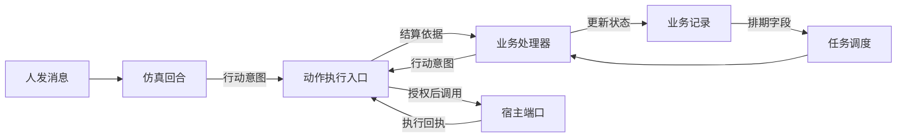

# Core 调度与动作执行 V1

2026-11-22 设计定稿，代码基线为主线 `f86dbd9`。[基线提交](https://github.com/WoJiSama/shiloh-plugin/commit/f86dbd9fc9ef129bdb28ada07b200d9f93ab5bc2)

## 模块职责

在同一个 Core 进程内收拢任务调度和动作执行。调度负责发现到期工作、领取和重启接续。业务模块持有原记录，负责解释什么算完成，以及是否需要安排下一次。动作执行在实际读、写、投递前核验授权，通过宿主端口取得结果，再交业务模块结算。仓库已有承诺领取和 QQ 投递回执，V1 以这两处契约为起点。[承诺账本](https://github.com/WoJiSama/shiloh-plugin/blob/f86dbd9fc9ef129bdb28ada07b200d9f93ab5bc2/src/modules/commitments/infrastructure/commitmentStore.ts#L262) [投递回执](https://github.com/WoJiSama/shiloh-plugin/blob/f86dbd9fc9ef129bdb28ada07b200d9f93ab5bc2/src/contracts/delivery.ts#L1)

| 状态 | 持有者 | 写入边界 |
| --- | --- | --- |
| 本人档案、兴趣、自主目标 | 希洛本人，以稳定 `agentId` 归属 | 由对应的本人回合或工作处理器提交。档案修订只使用当前本人档案。 |
| 对话上下文、消息来源、会话权限 | 原账号与会话 | Core 根据当前绑定和来源有效性读取。群内记录保留原场景。 |
| 承诺及投递结果 | 承诺账本与对应动作回执 | 账本确认登记，平台回执确认送达。两种结果各有自己的状态。 |
| 到期时间、领取标识、租约 | 对应的业务记录与到期索引 | 业务结算时确定下次到期。调度按当前版本更新领取标识和租约。 |
| 能力、授权、额度 | 宿主配置和平台规则 | Core 复核本次动作的实际权限。踢人始终排除在能力表之外。 |

## 调度和恢复

每项工作带着原业务记录的引用、到期时间和当前修订号。领取时记录本次领取标识及租约。一个到期动作在重启和重新领取时沿用同一个执行标识，新领取者使用自己的领取标识。提交时校验记录版本和领取标识，过期的处理器不能覆盖更新后的记录。

| 恢复时看到的状态 | 处理规则 |
| --- | --- |
| 已到期，或领取过期且尚未进入执行 | 按当前排期和权限重新领取。 |
| 公开资料读取已开始，结果未提交 | 待领取到期后可以重新读取。按来源条目标识去重，以当前版本提交。 |
| QQ 派发已开始，结果未知 | 记为待核实。后续只安排同账号、同会话的回执核对。取得送达证据后再结算。 |
| 平台明确拒绝，或记录已变更 | 按业务规则记录失败、等候条件恢复或结束。迟到结果由当前性检查废弃。 |

投递入口在可能产生外部效果前持久记录执行标识和已开始状态。群提醒登记完成后才回复「记下了」。到了约定时间，业务处理器凭原承诺进入投递；前一次已开始发送但结果未知时，按上表核对。

兴趣更新选定分享后，摘要、条目去重与待发回执一起写入本人记录。排到发送时写入派发时间。重启后继续处理尚在排队的分享，已经开始的分享走原回执核实。

## 动作授权和并发

每次动作带上希洛的 `agentId`、回合或任务来源、执行主体和动作类型。涉及会话时，Core 解析完整目标地址及绑定版本；涉及原消息时，带上可复核的来源引用。模型负责提出意图，Core 负责填入可信身份、版本和权限。外发前复核绑定、来源、隐私和配额，并沿用宿主回执。[绑定契约](https://github.com/WoJiSama/shiloh-plugin/blob/f86dbd9fc9ef129bdb28ada07b200d9f93ab5bc2/src/contracts/agentBinding.ts)

真人 `@` 和点名沿用仿真回合，可以读取同群获准的上下文。自主分享按当前主动接话或好友联系权限执行。已登记的提醒以原承诺授权为依据，关闭主动接话时仍按原排期处理，到期时复核原账号、会话和任务权限。

希洛正在读取游戏公告时，群友点名和八点提醒可以各自开始。后台查询、聊天推理、预约投递各有自己的执行容量。发往同一会话的消息在该会话的投递队列中排队，出队时再复核。多个回合写同一份业务记录时，通过版本检查处理冲突，由冲突方读取新状态后重新判断。

## 首批迁移

1. 公开兴趣检查通过新调度入口领取和续排，继续读取本人现有的跟进记录、条目去重状态和摘要。读取中断可以重试，允许分享的更新走动作入口。[本人跟进与排期](https://github.com/WoJiSama/shiloh-plugin/blob/f86dbd9fc9ef129bdb28ada07b200d9f93ab5bc2/src/modules/simulation/infrastructure/agentPersonalRuntime.ts#L535)
2. 一次性群提醒接入同一调度入口，复用现有承诺账本的领取、已开始标记和投递回执。以当前实例和任务类型切换领取者。切换或回切前停止原入口领取，核对已领任务和待核实回执，再从原记录接续。

V1 以部署版本 `c7d58d3` 为实现起点，继续使用原 Redis 作用域和索引。群提醒用承诺 ID 表示同一次到期动作，兴趣检查用跟进 ID 和该次到期时间定位。新增来源和派发数据随原记录保存。部署使用同一实例的独占租约，进程切换自然交接领取权。回切到支持 V1 记录的构建可继续核实。回切到旧构建前，须核对 V1 已登记的到期提醒和待核实记录。

## 验收

| 场景 | 通过条件 |
| --- | --- |
| 公开源首查和重启 | 首次成功读取只建立基线。新条目可以触发一次摘要决定。相同条目再次读到时，保持原摘要与分享进度。 |
| 公开源读取中断或停止跟进 | 可恢复的读取失败按计划重试。跟进已结束时，迟到结果被丢弃。 |
| 群提醒领取后、发送前重启 | 新进程从同一承诺记录接续，以同一到期动作核对，最终得到一次确认送达。 |
| QQ 接收后回执丢失 | 重启后进入待核实，保留已有执行标识。核对到平台证据后才标记送达。 |
| 关闭群主动接话 | 群内 `@` 仍能开启仿真并读取授权上下文，已登记提醒按期核验并投递。 |
| 到期前换绑或撤销来源权限 | 到期任务按当前授权判断。权限失效时记录原因，外发次数为零。 |
| 后台检查、点名和提醒同时发生 | 后台读取保持在自己的工作容量中，点名和提醒可及时进入各自路径。同一会话的外发走同一投递队列。 |
| 切换调度入口 | 原任务的标识、到期时间和待核实状态可连续读取，同一时间只有一个领取入口。 |
